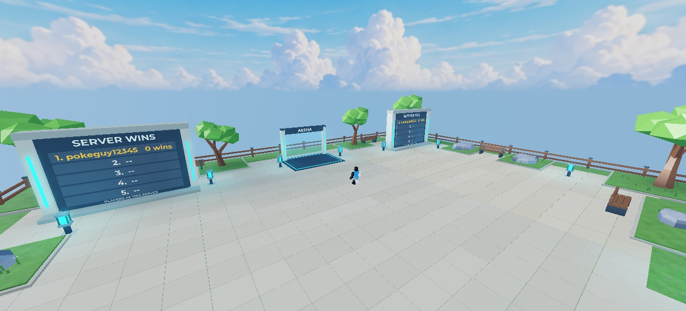
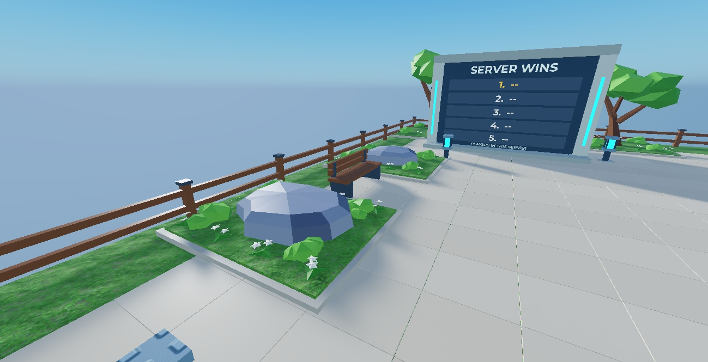

# Low-poly nature lobby — 2026-10-24

Owner requested the lobby receive the approved arena treatment. Installed six instances of the approved faceted trees, six low rocks, twelve garden beds, textured grass, warmer smooth paving, and coordinated wood/metal colors on the existing benches and fence. Four corner trees reuse the existing trunk colliders; two portal-side trees have matching small trunk colliders.

The two server boards and simple cyan gate keep their original geometry and signs. Spawn, teleport pad, floor, bounds, footprint, elevation and arena geometry are unchanged. The central route stays clear. The owner subsequently approved the new bushes/flower clump; they are installed in all twelve beds (see the planting follow-up below).

## Implementation and rollback

- Approved group-owned templates are reused from `ServerStorage.MapProps.LowPolyNature`; no new uploads or mesh generation.
- `NatureLobbyPolish.Apply` is called by `PilotEnvironment` without changing environment version 12, Elevation 180 or LobbyLift 60.
- Replaced original decoration (644 roots, including paving and fence parts) is archived under `ServerStorage.PolishOld.Lobby_Nature_v1`.
- `scripts/studio/place_nature_lobby.luau` wraps placement in one area recording, or uses the recording already owned by MCP. Initial placement and two visual/contact refinements were separate area-wide undo steps, not one step per prop. A fresh placement script applies the final version in one recording.
- Revision 3 removes surface overlap with the protected studded floor: grass overlay top is Y=240.3; replacement paving top is Y=240.42. Paving stays plain parts and now provides collision at its visible surface. Grass overlay remains noncolliding. Original floor and paving are retained.
- Missing verified tree/rock templates abort before live changes. Optional undergrowth meshes are used only if all three imported templates exist and are verified. Repeated Apply calls do not create more decoration or archives.

## Verification

- All 59 protected BaseParts captured in [the baseline](reference/low-poly-nature/lobby-protected-before.json), including the complete portal, match after placement: transforms, sizes, colors, materials, transparency and collision/query/touch flags. Both boards and their descendants were not edited.
- Arena BasePart paths/transforms/sizes/materials/colors/collision match the pre-lobby snapshot; arena descendant count stays 787.
- Six trees and six rocks fit inside the floor bounds. Trees use 194 triangles per variant; rocks use 46/58/64 triangles. Twelve planters stay off the central approach.
- Fresh Play uses revision 3. Repeated Apply is idempotent; archive remains 644 roots. All 36 mesh components preload successfully.
- Player root stands at Y=243.394 on the visible paving at Y=240.420; raycast excluding the noncolliding spawn plate hits the collidable PlazaPaving.
- Character navigation from spawn to the pad successfully enters the live arena, including after the paving collision adjustment.
- Server wins/KO labels update in Play. The cyan portal remains distinct.
- [iPhone 17 Pro landscape screenshot](reference/low-poly-nature/lobby-nature-phone.jpg) reviewed. StarterGui orientation is Sensor. Existing prototype HUD overlays portions of the scene/left board; this pass does not redesign that UI. Physical board rows require approaching the board to read at phone size. Portrait was not retested for this scenery change.
- Selene on src and scripts/studio: 0 errors, warnings or parse errors, using the cached Roblox API because online API-dump refresh failed. Rojo build passed.
- Existing unrelated Output warnings: Studio data saving disabled; asset 203785492 type mismatch. No new lobby-script runtime errors observed.
- Play stopped, default device viewport restored, Studio save shortcut completed. HUD hiding was Play-only and discarded on Stop. No game publication or Git push.

This is a local Studio visual/functional check, not multiplayer release acceptance. New fence meshes and optional stair trim remain outside this installed pass.

## Approved planting follow-up ? 2026-10-24

The owner answered "Yes, use those bushes and flowers". Finished the approved source unchanged, using the existing static FBX exporter: BushA, BushB and FlowerClump remain 60 triangles each, two colored MeshParts per model. All three round trips pass geometry, size, pivot and flat-normal validation. Uploaded to the same group as the experience; IDs and hashes are in scripts/asset_ids.json.

- BushA: 125190783968134; BushB: 136381056003772; FlowerClump: 106816410291370.
- Placed 48 bushes and 96 flower clumps in twelve beds. All rotated bounds stay within their grass bed; zero colliding/queryable/touchable plant components.
- Old small-plant groups were archived, as were the first placement copies when their edge spacing was corrected. Lobby archive now contains 666 roots (644 initial, 10 old plant groups, 12 first-pass groups).
- PlantRevision 2 is idempotent. All 324 lobby mesh components preload successfully in fresh Play. All 59 protected parts remain unchanged. Arena geometry was not edited.
- Phone landscape review confirms cream flowers and green bushes read against the grass. Existing HUD overlays remain. Selene and Rojo pass; only the same unrelated Output warnings remain.
- Play stopped, default viewport restored and Studio saved after placement. No publication or push.

[Phone review](reference/low-poly-nature/lobby-garden-phone.jpg). Use `scripts/studio/normalize_nature_undergrowth.luau` after inserting the templates and `place_nature_lobby.luau` to apply planting to an existing lobby.
